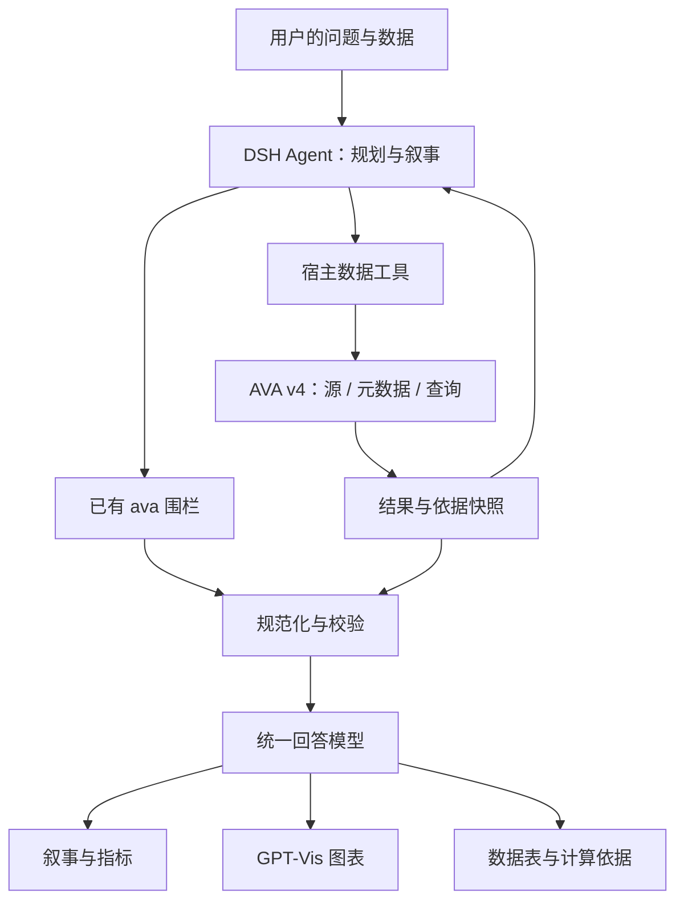

# DSH × AVA v4：对话式数据分析插件设计

日期：2026-10-26。状态：首期实现已落地，具体完成范围与边界见 [实现状态](./implementation-status.md)。依据：当前插件 0.2.0、AVA 4.0.0-beta.2 发布包、当前官方文档、GPT-Vis 1.0.0。本文中的工具名称、内部协议和目录是拟议设计，不代表 DSH 已提供对应接口。

## 1. 产品目标与架构决定

插件提供“有数据依据、可继续追问的可视化回答”。保留融入聊天正文的叙事、流式更新和轻量图表，增加文件分析、结果复查和业务口径。

职责分工：DSH Agent 理解问题和组织回答；AVA v4 管理数据源并执行计算；插件维护结果协议、事实引用和展示。浏览器渲染过程不发起分析，恢复历史消息不重新执行查询。

采用一套展示内核和两条输入路径：

- **内联展示**：用户已有数字，Agent 生成现有 `ava` 围栏，经过兼容解析器进入展示内核。无需初始化 AVA v4。
- **数据分析**：用户提供文件或已配置的数据源，宿主执行工具，保存结果快照，回答引用结果生成叙事和图表。

用户通过问题自然进入相应路径。产品界面无需让用户选择 SDK、CLI、策略或执行引擎。



首期范围：内联数字、CSV/JSON/Excel、单数据集、DuckDB、常用统计图、现有围栏回放。多数据集联结、远程连接配置 UI、Python 执行、自定义分析引擎在后续阶段评估。

## 2. 哪些部分需要重设计

| 当前模块 | 已观察到的问题 | 建议 |
| --- | --- | --- |
| `src/client/ava-source.ts` | 同时承担协议识别、流式处理、安全检查和 AVA 3 类型构造 | 拆成旧协议解码、内部文档模型、增量处理、图表校验；保留输入兼容 |
| `src/client/ava-analysis.ts` | 从图表配置推断字段，数值默认按 SUM 分析；异常也返回空 patterns | 改为可选的 legacy 统计适配器；新分析以执行结果和明确口径为输入 |
| `src/client/AvaBlock.tsx` | 图表、主题、分析和状态耦合；主题变化会再次调用分析 | 拆为回答容器、图表运行时、主题桥接与结果状态，计算由宿主驱动 |
| `src/client/NtvBlock.tsx` | 自有 React 渲染器，但依赖已从 v4 移除的 NTV 类型 | 保留渲染经验，定义插件自有的短语/段落模型 |
| `asset-loader.ts` / `asset-ava.ts` | 图表和统计统一加载；加载失败的 Promise 一直复用 | 按图表与可选统计能力拆分加载；失败可明确重试 |
| `src/plugin/index.ts` | 目前只有提示词注入与静态资源路由 | 增加独立宿主适配层、可选运行时接入、结果存储；提示词按能力注入 |
| `dom-fence.tsx` | 全文 DOM 扫描和流式状态启发式判断 | 隔离为兼容适配器，保留降级；优先使用已探测到的官方围栏注册能力 |
| `styles.ts` | 字体继承有效，但业务数值颜色与布局限制较硬 | 保留宿主排版；抽取语义 token，统一响应式、焦点和暗色表现 |

当前字段推断还会遗漏直方图的数字数组、双轴图的 categories/series 等结构。图表配置只是结果的一种表达，不能作为完整分析数据源。

## 3. 以插件自己的结果模型作为稳定边界

AVA 的 `DataModel` 用于分析上下文；插件的 `AnswerDocument` 用于回答展示。二者通过适配器连接，客户端不直接依赖 AVA 的类型声明。

内部模型拆为四个对象：

| 对象 | 主要内容 | 创建者 |
| --- | --- | --- |
| DatasetHandle | 不透明 ID、显示名、数据源版本、能力、过期状态 | 宿主运行时 |
| ResultSnapshot | resultId、查询输出字段/数据、截断信息、执行依据 | 宿主运行时 |
| AnswerDocument | 文档版本、叙事、指标、视图、结果引用 | 编排与协议层 |
| ViewSpec | 图表选择、字段绑定、显示配置、数据范围 | Agent 提议，校验器确认 |

最小协议形状如下，实际实现需配套运行时 schema：

```ts
type JsonValue = null | boolean | number | string | JsonValue[]
  | { [key: string]: JsonValue };

interface ResultSnapshot {
  id: string;
  datasetId: string;
  datasetVersion: string;
  semanticVersion?: string;
  queryId: string;
  columns: Array<{
    id: string;
    logicalType: 'number' | 'string' | 'boolean' | 'date' | 'unknown';
    encoding?: 'decimal-string' | 'integer-string' | 'iso-date';
    unit?: string;
  }>;
  rows: Array<Record<string, JsonValue>>;
  rowKeys: string[];
  returnedRows: number;
  totalRows?: number; // 只有实际已知时才填
  truncated: boolean;
  truncatedBy?: Array<'rows' | 'bytes'>;
  executedAt: string;
  executionRef: string; // 指向宿主保存的执行记录
}

type ValueRef = { resultId: string; rowKey: string; columnId: string };

type Phrase =
  | { kind: 'text'; text: string }
  | { kind: 'value'; ref: ValueRef; format: 'number' | 'money' | 'percent' }
  | { kind: 'literal'; text: string; origin: 'supplied' | 'legacy' };

interface AnswerDocument {
  schemaVersion: 1; // 插件协议版本，独立于 AVA 的主版本
  id: string;
  revision: number;
  source: 'inline' | 'analysis';
  resultIds: string[];
  blocks: Array<
    | { id: string; kind: 'paragraph'; phrases: Phrase[] }
    | { id: string; kind: 'metric'; label: string; value: ValueRef }
    | { id: string; kind: 'chart'; viewId: string }
  >;
}
```

协议约束：

- 模型返回的 `resultId` 必须由宿主按会话权限解析；任何模型自写的“已验证”标记都不能形成执行证据。
- “已执行”只证明结果来自一次成功计算，不证明模型对业务含义的解释正确。业务口径、查询范围和推断文字应分别表达。
- 新分析的数值短语引用结果单元格。变化率、净贡献等先计算为派生结果，保留公式、分子分母和父结果引用，再用于展示。
- 内联/旧消息保留原始数值与来源性质；它们不自动获得查询执行标记。
- decimal / 大整数保留精度。只有图表适配器在检查安全范围后转换为 number；表格和下载保持原值。
- MVP 结果表保留标量字段，嵌套结构需显式转换。树图和关系图由单独的受支持转换生成，避免通用对象透传。
- 固化结果与展示配置，使历史消息在运行时会话失效后仍可回放。复查显示当时结果；重新分析生成新的结果 ID。
- 本地文件可记录内容摘要；远程源没有事务快照时标记为尽力复现，不能只凭时间戳声称完全可复现。

## 4. 宿主计算层：优先复用 DSH Agent

默认路径由 DSH Agent 生成查询和叙事，AVA 执行 `source/schema/profile/query`。避免一次用户请求同时运行两套完整的规划与总结流程。

建议暴露的工具能力如下，名称是插件设计草案：

| 能力 | 输入 | 输出 |
| --- | --- | --- |
| `ava_dataset_open` | 已授权附件/连接引用、读取选项 | DatasetHandle |
| `ava_dataset_inspect` | datasetId、所需 schema/profile 范围 | 精简元数据、可用口径 |
| `ava_query` | datasetId、查询、结果预算 | ResultSnapshot 引用与有界预览 |
| `ava_result_present` | resultId、视图意图/配置、事实引用 | 已校验的回答或视图片段 |
| `ava_dataset_close` | datasetId | 资源释放结果 |

数据工具必须绑定会话身份和输入来源。远程连接使用宿主连接引用；浏览器和提示词只看到显示名及授权范围。默认 DuckDB 查询采用只读执行与资源限额。SQL 内容即使来自模型也要经过执行策略校验；宿主负责限制可访问的数据源和文件范围。

默认采用独立、可选的 AVA v4 运行时包/进程；纯展示插件安装不应强制拉取 DuckDB 原生依赖或提高 Node 要求。开发时可先在同仓库分目录，运行时实现为独立入口；正式发布按依赖边界拆包。

可选运行时要求 Node ≥22.13。CLI 可用于接入验证和有 shell 能力的 Agent；产品集成优先使用 SDK 包装的工具服务，以便管理结果、会话和错误。CLI 的 datasetId 不能与 SDK 实例或插件 datasetId 混用。

AVA 实例只持有一个活动数据源。每个 dataset session 独立管理实例；同实例操作串行排队。数据源或语义版本变更使相关缓存失效。插件卸载、会话结束和 TTL 到期时等待 `dispose()`；清理失败可诊断且不伪装成功。

如果 DSH 工具接入能力尚未确认，首期仅交付展示内核与结果协议，保留 CLI 验证路径。本仓库目前没有可证明可用的工具注册和跨端事件契约，不能把它们当作现成服务。

## 5. AVA 自主分析作为第二条执行路径

需要 AVA 自己完成自然语言分析时，再启用 `analyze()` 和 `recommend()`。模型配置由宿主提供；DSH 模型客户端能否直接适配 AI SDK 的 LanguageModel，需要验证，不能默认两者兼容。

- 默认显式使用 `strategy: { type: 'direct', maxRetries: 2 }`，并设置行数、字节、查询时限和整体运行预算。
- DSH 负责最终叙事时可设 `includeSummary: false`，减少重复总结。
- 多步探索在具体问题上启用有界 loop；它不应成为所有任务的默认路径。
- beta.2 的 subset 选择器额外使用 `typesafe-ai/jev`，初期不开启。后续只有在服务可用、成本与数据流向明确时再评估。
- 需要自动选图时调用 `recommend()`，接收 `{ chartType, config }`；校验数据映射后进入统一展示层。不要直接将生成 HTML 嵌入聊天 DOM。

`semantic()` 描述业务含义，不是数据权限机制，也不会自动建立物理视图。Agent 直接编写 SQL 时，需要 inspect 工具把口径提供给 Agent；仅调用 semantic setter 不会自动改写已有 SQL。必要的口径约束还需执行前检查与派生指标计算。

## 6. 流式处理：三个独立状态

分别管理执行状态、文档状态和图表资源状态：

| 状态域 | 状态示例 | 关键规则 |
| --- | --- | --- |
| Run | queued / loading / computing / completed / failed / cancelled | 来自宿主，不由 React 挂载触发 |
| Document | receiving / partial / complete / invalid | 管理短语、完整数据项与最终严格校验 |
| Chart runtime | unloaded / loading / ready / failed | 失败只影响该图表，保留文字和数据 |

AVA 的生命周期事件用于显示“读取数据”“计算结果”“整理回答”等阶段。它们不等于 token 流，也不保证查询行逐批返回。`queryend` 等 end 事件可能带 error；仅收到 end 不能标记成功。推荐配置通常在 Promise 完成后整体交付。

插件传输层可定义如下事件，但这不是 AVA 原生 API：

```ts
type AnswerEvent = {
  runId: string;
  seq: number;
  documentId: string;
  revision: number;
} & (
  | { type: 'phase'; phase: string }
  | { type: 'snapshot'; document: AnswerDocument }
  | { type: 'paragraph.replace'; blockId: string; phrases: Phrase[] }
  | { type: 'chart.replace'; viewId: string; resultId: string }
  | { type: 'complete' }
  | { type: 'error'; code: string; message: string }
);
```

规则：序号去重；丢包时请求完整快照；新 run 隔离旧回调；终态后丢弃迟到更新；整体替换图表比解析任意半截 JSON 更可靠。传输优先复用经确认的 DSH 通道，只有确有必要才新增 RPC/SSE。

旧围栏的累积文本按完整行生成预览，EOF 时允许完整的最后一行；已输出前缀发生修改时显式重解析，保持块 ID 稳定。每次流更新只执行一次协议解析，向下传入规范化文档。短语尽快提交，图表建议每 100–200ms 合并一次更新；已显示的有效图表保留到下一份有效配置出现。数字未算出时显示阶段状态，不填猜测值。

beta.2 的公开分析接口未提供通用 AbortSignal。取消先使 run 失效并抑制后续输出，再按适配器能力中止执行；需要强制终止时使用独立 worker/process 和超时边界。若执行不可中断，界面明确为“已停止接收，计算正在清理”。不在正在执行的共享实例上直接并发 dispose。

## 7. 可视化：建立可检验的表达规则

将“可渲染”与“适合这份数据”分别校验。先提供 8 类可靠视图：line、bar、column、pie、scatter、histogram、waterfall、table；其他已支持类型继续走 legacy 路径，在配置映射和覆盖验证完成后加入新分析路径。

| 分析意图 | 默认表达 | 必须检查 |
| --- | --- | --- |
| 单指标、同比环比 | 正文中的数值与变化 | 期间、单位、基数为零、百分比与百分点 |
| 时间趋势 | 折线 | 时间排序、粒度、缺失区间；缺失不自动补零 |
| 排名/比较 | 横向条形或柱形 | 零基线、可见分类数量、长标签 |
| 构成 | 条形优先，少量非负类别可用饼图 | 分母、负数、总量、是否截断 |
| 净变化拆解 | 正负条形，适合时用瀑布图 | 各项之和与总变化一致；净贡献比例可能超过 100% |
| 分布 | 直方图 | 原始数值或明确的分桶结果；分桶口径可复查 |
| 相关性 | 散点 | 成对数值、样本量与缺失；相关不推导因果 |
| 精确查阅/不适合图表 | 数据表 | 保留精度、单位、空值和截断提示 |

颜色以宿主语义 token 和稳定的系列映射为准。变化方向与业务好坏分开：费用上升不能自动显示为利好。使用文字/符号辅助颜色，暗色下检查文字与图形对比度。图表、表格和叙事必须引用相同结果范围。

`truncated`、`sampled`、`aggregated`、`display-limited` 是不同状态。例如“展示前 20 类”不等于查询只返回 20 行。计算总体占比必须使用总体分母，不能拿截断结果重新求百分比。Top-N 的“其他”只能由完整数据聚合得到。明细范围无法证明时，显示范围限制。

图表输入采用图表类型白名单和逐类型 schema；拒绝函数、表达式、可执行标记、原型污染键和未经批准的外部资源。仅通过 JSON.parse 不代表配置可安全透传。配置中所有数据都需与绑定结果及显式变换一致；无法证明映射时回退表格。

### NTV 与 T8 的取舍

首期保留自有 React 叙事渲染器，去除 AVA 3 类型依赖。它已经满足宿主排版、短语流式、高亮、箭头和占比表达。

GPT-Vis 1.0 的 Summary 使用 `@antv/t8`，输入类型是 T8 字符串。AVA beta.2 虽将 `summary` 列入 ChartType，但不能据此假定 `{ type: 'summary', data: ... }` 可直接运行。新 JSON 图表入口先排除 summary。后续单独验证 T8 的安全性、增量更新、主题和可访问性，再决定是否作为兼容适配器。

## 8. 前端组件与运行时

建议目录：

```text
src/
  protocol/          # 自有类型、版本、运行时校验、事件 reducer
  compatibility/     # 旧围栏、旧 NTV、可选 v3 统计
  client/
    adapters/        # DSH registry 与 DOM fallback
    runtime/         # GPT-Vis loader、主题桥、更新调度、导出
    components/      # AnswerView、NarrativeView、ChartView、ResultTable、EvidenceView
  plugin/            # 提示词、资源路由、宿主能力探测
runtime/             # 拟议独立包：AVA v4、session、tools、snapshot store
docs/design/         # 本设计和交互原型
```

- AnswerView 接收文档与结果，不依赖 SDK；子块有各自错误边界。
- ChartView 只管理图表生命周期。数据、主题、容器大小分别更新，任何一项都不触发重新分析。
- GPT-Vis 同图类型可复用实例；切换类型按它的 API 更新/销毁。其 `render()` 返回 void，不能虚构可 await 的绘制完成事件；导出就绪需适配真实渲染器行为。
- ThemeBridge 优先使用经确认的宿主主题信号；现有 DOM 推断作为回退。观察器挂载一次，避免每个文本分片重建观察器。
- 容器采用可收缩布局和 ResizeObserver。大表只加载有界预览，按需分页；图表上屏时加载运行时，纯文字回答无需加载图表包。
- React 18/19 均要支持，不依赖仅 React 19.2 提供的 useEffectEvent。
- 导出按图表能力提供 PNG/SVG/CSV；不假设所有图表都有 Canvas。不支持的导出选项不展示。
- 客户端成功/错误度量不记录原始数据；同结果渲染缓存与执行缓存分开。执行缓存需包含源版本、语义版本、查询和权限范围。

## 9. 对话中的交互设计

回答顺序：一句主要发现 → 必要的数值/变化 → 支撑图表 → 数据与计算依据 → 少量相关追问。

默认保持聊天正文样式；避免每段内容都套卡片。原型中的外层控制条仅用于评审，不进入正式产品。

| 时刻 | 用户看到的内容 | 可用操作 |
| --- | --- | --- |
| 读取/计算中 | 简短阶段文本与数据源名，不使用伪进度百分比 | 在运行时支持时取消 |
| 数据就绪、文字生成中 | 已完成的结果或表格，叙事逐段出现 | 查看已有数据 |
| 完成 | 结论、图表、范围提示 | 图表/数据切换、查看计算依据、按能力导出 |
| 查询失败 | 可理解的错误和重试入口 | 保留用户问题与读取选项 |
| 图表失败 | 保留叙事，自动展示结果表 | 重试图表，不重复查询 |
| 历史数据源过期 | 已存结果仍可查看，注明计算时间 | 显式重新连接后分析 |

“数据来源与口径”面向普通用户，展示数据集名称、时间范围、币种/单位、排除规则和展示范围。“查询详情”在其中折叠，供需要复查的人查看。界面中的“来自已执行查询”不标成统计置信度。

可访问性：数据表始终可达；图形有摘要；所有操作支持键盘；进度按阶段使用 aria-live，避免每个 token 播报；尊重 reduced-motion。窄屏优先保留结论与图表，表格在自身容器内滚动，页面不横向溢出。

## 10. 迁移顺序与验收

| 阶段 | 范围 | 完成标准 |
| --- | --- | --- |
| P0：统一展示内核 | 自有 NTV 类型、规范化文档、解析/渲染拆分、主题解耦 | 旧围栏与历史消息完整回放；主题变化和重新挂载不调用计算 |
| P1：v4 结果接入 | JSON 图表校验、结果表、依据快照、流式状态 | 空结果/截断/错误有区别；图表失败保留表格；数值与来源一致 |
| P2：可选执行层 | DSH 工具接口验证、DuckDB 文件分析、会话资源管理 | 从文件到结果再到回答闭环；无需第二套模型配置的默认路径可用 |
| P3：扩展分析 | 业务语义、多数据源、按需 analyze/recommend/suggest | 有任务评测后再开放；默认预算清晰，结果可回放 |

迁移期 legacy 统计继续固定 3.4.1，可用 npm alias 隔离；从图表包拆出后按需加载。新路径不依赖它。待历史能力与测试覆盖完整，再决定是否移除，不能在依赖升级中静默删除已有统计能力。

有价值的验证场景：

1. 旧 DSL 任意位置分片，空输入、末行无换行、半条数据和前缀修订。
2. 执行结果重复、乱序、断线重连和取消后的迟到事件。
3. 币种与单位、整数精度、零分母、负数、日期缺口、占比与百分点。
4. 图表与表格共享结果；推荐配置改写数值时拒绝；截断数据不生成总体结论。
5. 主题切换、容器 resize、滚动离屏重挂载均产生 0 次额外查询或模型请求。
6. 运行时不可用、图表加载失败、查询失败、分析未运行和未发现显著模式分别处理。
7. 真正的引擎测试检查合成数据的精确聚合结果；LLM 质量测试与确定性测试分开，不依赖自然语言逐字匹配。
8. 开发阶段量测首屏包、图表包、首个可见内容时延、查询成本和卸载后资源。性能目标先建立基线，再设阈值。

首个实现 PR 建议只完成 P0，下一 PR 用固定 ResultSnapshot 完成 P1。P2 的 DSH 接口和独立运行时验证单独进行，避免后端接入问题拖住已有展示体验。

## 11. 实施前仍需验证的边界

- 当前 DSH 的工具注册、会话标识、结果持久化、事件订阅和取消接口；已确认的仅是本仓库实际使用的提示词和资源路由，以及运行时探测的围栏扩展。
- DSH 模型客户端与 AI SDK v7 的桥接方式；缺失时默认使用 Agent 自行生成查询的路径。
- GPT-Vis 各图类型的主题、resize、导出和可靠完成判定；能力不能由类型名称推断。
- beta 包的实际 exports 与在线文档差异。例如 beta.2 的 browser 入口没有导出 registerEngine，不能仅凭自定义引擎文档调用它。
- 独立运行时的安装、进程生命周期及宿主兼容矩阵；纯展示插件不隐式安装全局 CLI。

## 12. 依据

- [AVA v4 文档入口](https://ava.antv.vision/documentation/)
- [业务语义](https://ava.antv.vision/documentation/data/semantic/)
- [分析策略](https://ava.antv.vision/documentation/analysis/strategies/)
- [可视化与 GPT-Vis config](https://ava.antv.vision/documentation/visualization/overview/)
- [事件与生命周期](https://ava.antv.vision/documentation/reference/events/)
- [Agent Skill 的分工](https://ava.antv.vision/documentation/agent-skill/)
- [浏览器能力边界](https://ava.antv.vision/documentation/browser/)
- [beta.2 的不可变源码](https://github.com/antvis/AVA/tree/v4.0.0-beta.2)
- [beta.2 的公开类型](https://github.com/antvis/AVA/blob/v4.0.0-beta.2/src/types.ts)
- [交互原型](./ava-v4-prototype.html)：合成数据、前端模拟，无实际 AVA/DSH 请求。
